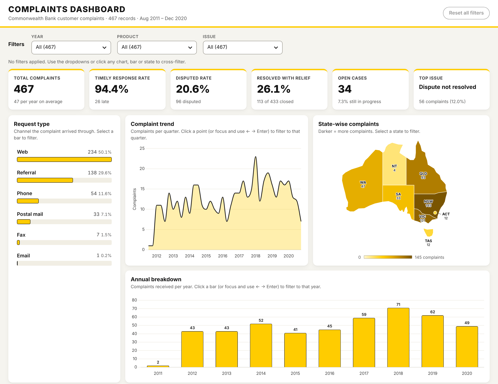

# Bank Complaints Dashboard

An interactive, HTML dashboard analysing 467 de-identified bank complaint records (Aug 2011 – Dec 2020).

**Live demo:** https://nymul-seam.github.io/commbank-complaints-dashboard/

## Problem statement
Track how customer complaints arrive and how well they are handled, by channel, product, issue, state and year.

## KPIs
Total Complaints · Timely Response Rate · Disputed Rate · Resolved with Relief Rate · Open Cases · Top Issue

## Process
1. Sketched a wireframe of the layout.
2. Wrote a structured AI prompt (RTIRCO framework) with clear requirements and a "do not invent data" constraint.
3. Cleaned and profiled the data in Python (pandas): trimmed empty rows and found no missing values or duplicates.
4. Built the dashboard: every chart filters the others, the KPIs update live, it works on mobile, and it is keyboard-accessible (WCAG AA).
5. Tested in a browser at desktop and mobile sizes.

## Key findings
- Web is the biggest channel: 234 complaints (50.1%).
- NSW, VIC and QLD account for 76.9% of complaints.
- Timely responses improved from 88.4% (2012) to 93.9% (2020).
- The disputed rate more than doubled, from 14.0% (2012) to 30.6% (2020).
- 26.1% of closed complaints (113 of 433) were resolved with relief.

## Tools
HTML · CSS · JavaScript · Chart.js · SVG · Python (pandas) · Excel · Claude 
